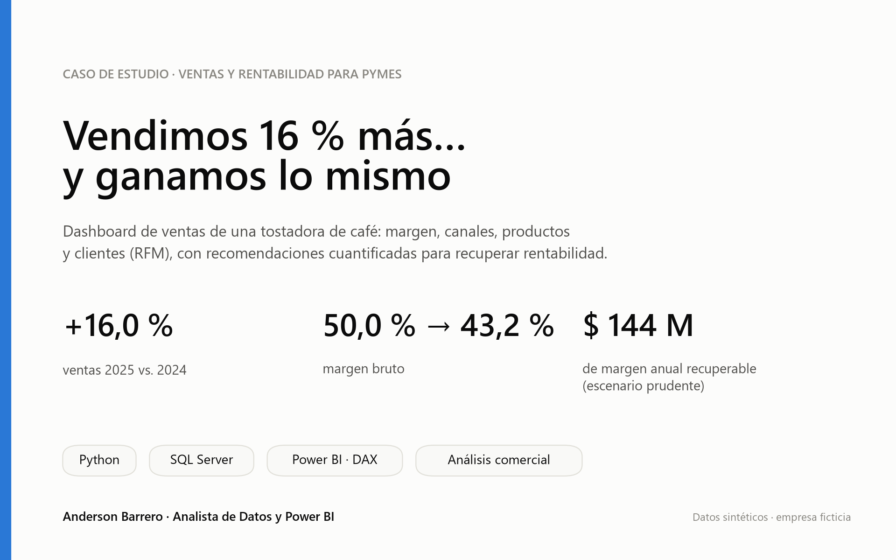
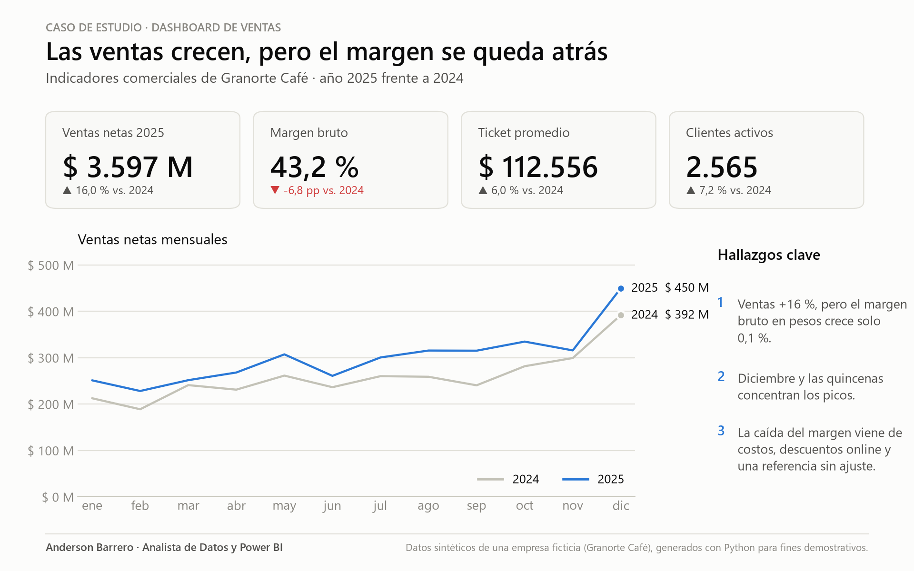
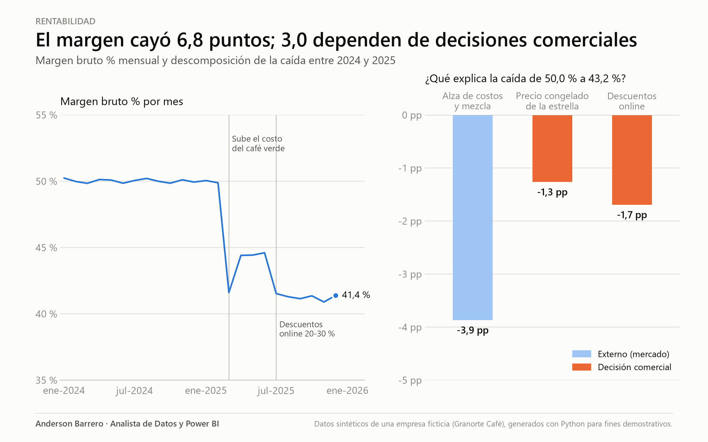
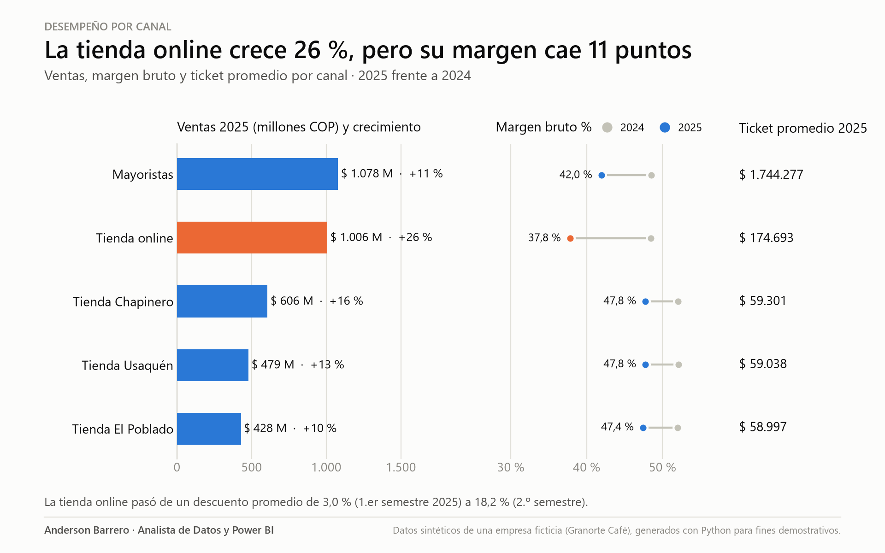
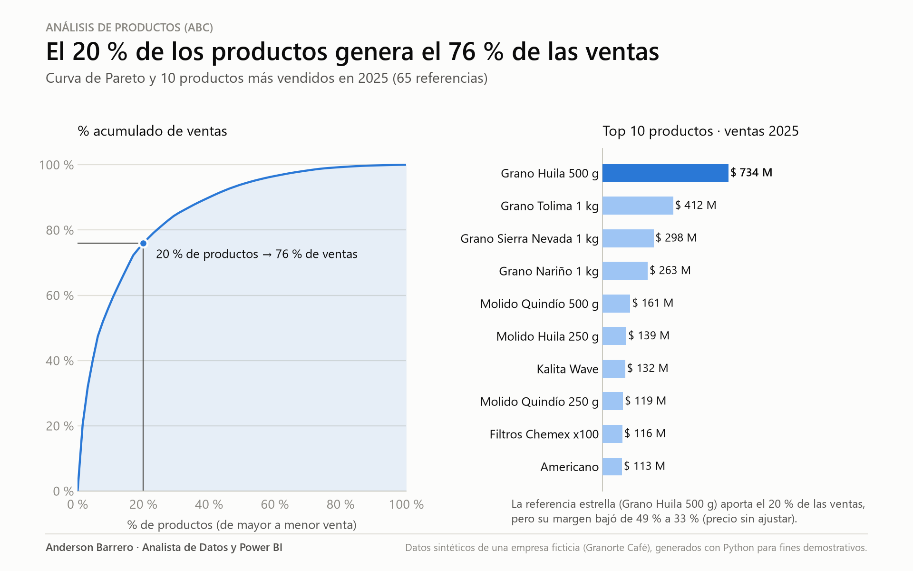
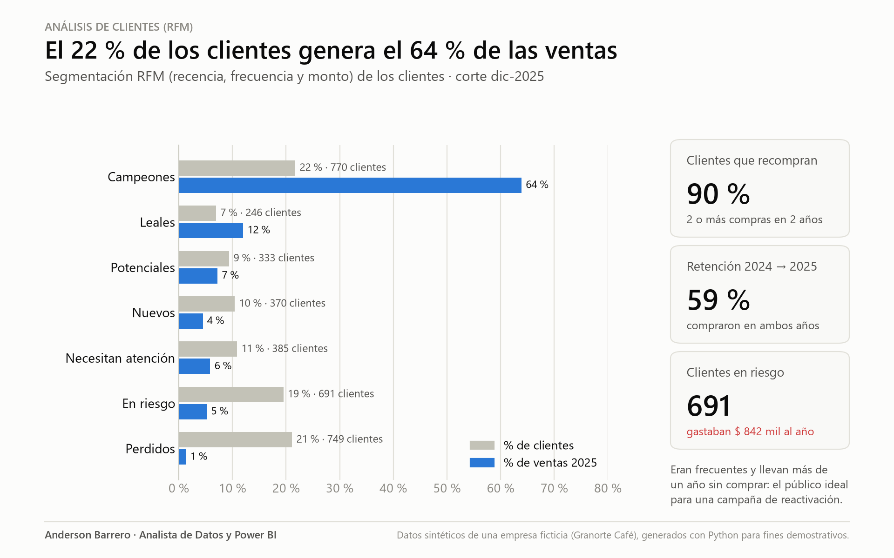
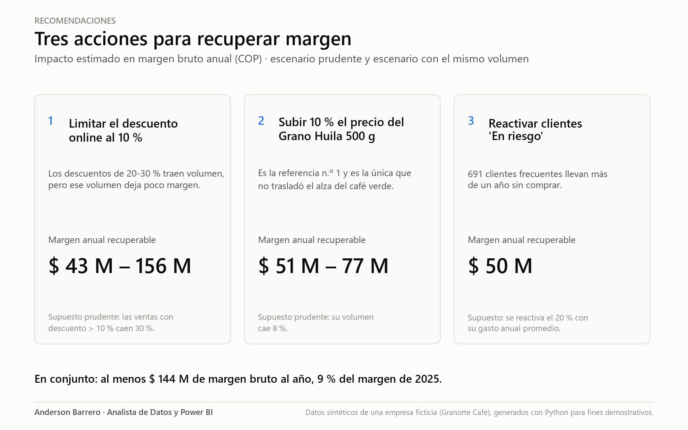

# Vendimos 16 % más… y ganamos lo mismo
### Caso de estudio: dashboard de ventas y rentabilidad para una pyme



> **Nota:** todos los datos son **sintéticos**. Los generé con Python para "Granorte Café", una tostadora de café de especialidad **ficticia**. No provienen de ninguna empresa real.

## El problema
Granorte Café vende por 3 tiendas físicas (Bogotá Chapinero, Bogotá Usaquén y Medellín El Poblado), una tienda online y un canal mayorista para cafeterías y restaurantes. En 2025 sus ventas crecieron 16,0 % ($ 3.102 M → $ 3.597 M COP), pero el margen bruto en pesos casi no se movió ($ 1.551 M → $ 1.554 M, +0,1 %). La gerencia quería saber **por qué el crecimiento no se convierte en utilidad y qué hacer**.

## Enfoque
| Paso | Pregunta | Técnica |
|---|---|---|
| 1. KPIs | ¿Cómo van ventas, margen, ticket y clientes? | Tablero comparativo 2025 vs. 2024 |
| 2. Rentabilidad | ¿Qué explica la caída del margen? | Margen % mensual y puente de margen (escenarios contrafactuales) |
| 3. Canales | ¿Dónde se pierde margen? | Ventas, margen %, ticket y descuento por canal |
| 4. Productos | ¿Qué productos sostienen el negocio? | Pareto y clasificación ABC |
| 5. Clientes | ¿Quiénes compran y a quiénes estamos perdiendo? | Segmentación RFM, recompra y retención |
| 6. Acciones | ¿Cuánto margen se puede recuperar? | Simulación de escenarios prudente y optimista |

## Hallazgos
1. **El margen bruto cayó de 50,0 % a 43,2 % (−6,8 pp).** El alza del costo del café verde y la mezcla explican 3,9 pp; **3,0 pp dependen de decisiones comerciales**.
2. **Descuentos online:** desde julio de 2025 el descuento promedio de la tienda online pasó de 3,0 % a 18,2 %. Ese canal creció 26 %, pero su margen bajó de 48,4 % a 37,8 % (−1,7 pp en el margen total).
3. **Referencia estrella sin ajuste de precio:** el Grano Huila 500 g es el producto n.º 1 (20 % de las ventas). Fue el único café que no subió de precio tras el alza del café verde, y su margen bajó de 49 % a 33 % (−1,3 pp en el margen total).
4. **Concentración:** el 20 % de los productos genera el 76 % de las ventas, y el 22 % de los clientes (los "Campeones") genera el 64 %.
5. **Clientes:** el 90 % recompra, pero la retención de 2024 a 2025 es del 59 %. Hay **691 clientes "En riesgo"**: eran frecuentes y llevan más de un año sin comprar.

## Recomendaciones (margen bruto anual)
| Acción | Escenario prudente | Mismo volumen |
|---|---|---|
| Limitar el descuento online al 10 % | $ 43 M | $ 156 M |
| Subir 10 % el precio del Grano Huila 500 g | $ 51 M | $ 77 M |
| Campaña de reactivación a clientes "En riesgo" (20 % de éxito) | $ 50 M | $ 50 M |
| **Total** | **$ 144 M (9 % del margen 2025)** | **$ 284 M** |

Supuestos prudentes: las ventas con descuento > 10 % caen 30 %, el volumen de la referencia estrella cae 8 % y se reactiva el 20 % de los clientes en riesgo con su gasto anual promedio.








## Estructura del proyecto
```
datos/                 ventas.csv, productos.csv, clientes.csv, canales.csv y resultados/ (tablas del análisis)
scripts/
  generar_datos.py     simulación de 2 años de ventas (estacionalidad, quincenas, precios y costos)
  analisis_ventas.py   KPIs, canales, puente de margen, Pareto/ABC, RFM y recomendaciones
  graficos.py          imágenes del caso
sql/consultas_ventas.sql   las mismas métricas en SQL Server (T-SQL)
powerbi/medidas_dax.md     modelo estrella y medidas DAX para el tablero
imagenes/                  gráficos del caso (1920x1200)
```

## Cómo ejecutarlo
```bash
pip install pandas numpy matplotlib
python scripts/generar_datos.py
python scripts/analisis_ventas.py
python scripts/graficos.py
```

## Herramientas
Python (pandas, NumPy, Matplotlib) · SQL Server · Power BI (DAX, Power Query) · Análisis comercial y de rentabilidad

---
**Anderson Barrero Saenz** · Analista de Datos y Power BI · [LinkedIn](https://www.linkedin.com/in/anderson-barrero-saenz/)

## Tablero de Power BI
- `powerbi/VentasGranorte/VentasGranorte.pbip`: tablero de 5 páginas (Resumen, Canales, Productos, Clientes RFM y Recomendaciones).
- Al abrirlo por primera vez, pulsa **Actualizar ahora** para cargar los CSV; después **Archivo > Guardar como > Archivo de Power BI (*.pbix)**.
- Los CSV se leen desde el parámetro `RutaDatos` (Transformar datos > Administrar parámetros).
